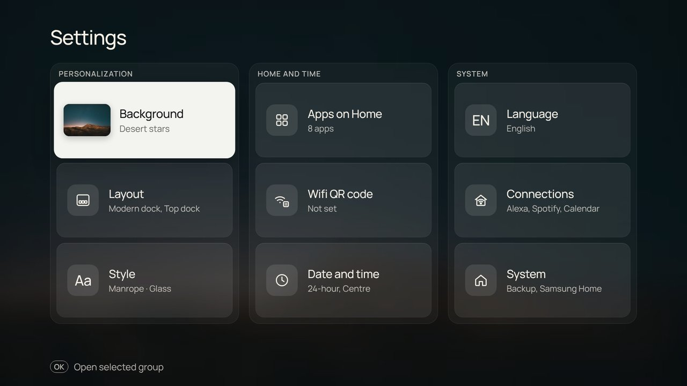
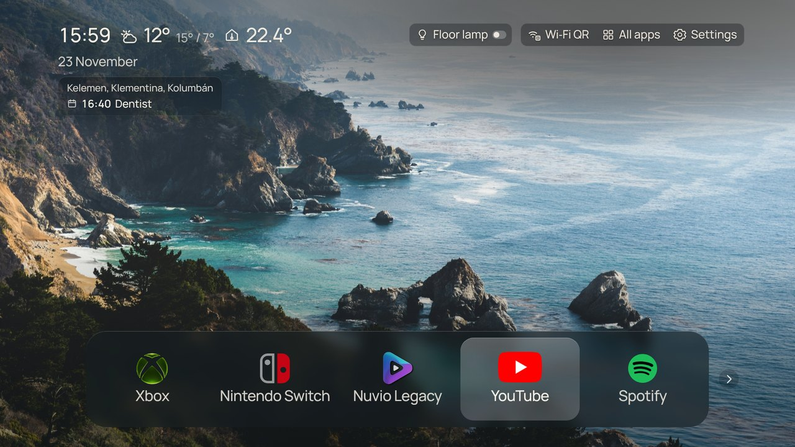

# CleanFrame (Frame Home)

> Personal fork of [nthnclrk/CleanFrame](https://github.com/nthnclrk/CleanFrame) — [bathoryalex/CleanFrame](https://github.com/bathoryalex/CleanFrame). See [FORK.md](FORK.md) and [docs/alex-tv-setup.md](docs/alex-tv-setup.md) for this installation.

A quieter home screen for Samsung TVs. Your apps, a photograph, the time and the weather, with an interface made for the TV remote.


*Top Dock bar, thin 24-hour clock with seconds, one panel with name days and events from two calendars (each marked with its name and colour), and the Modern dock with icons and names. Rendered in the browser preview on the Desert stars wallpaper with sample Spotify, Alexa and calendar data.*

This repo uses [Nathan Clark's CleanFrame](https://github.com/nthnclrk/CleanFrame) as a base and changes it to suit my Samsung TV (**Frame Home**, its own app identity). It is still evolving; upstream remains the better reference for a general-purpose project.

**Use it at your own risk.** Setup scripts, certificates and TV notes here match my machine and firmware. Fork again, start with the browser preview, and adapt before you install on your own hardware. Native Home/startup changes need particular care; the setup guide covers the risks and recovery steps.

| Settings | Dock layout |
| --- | --- |
|  |  |

## What it does

- **Home row.** Xbox and Nintendo Switch on HDMI, Nuvio, YouTube, Spotify, HBO Max, SmartThings and Internet by default. Choose and reorder up to nine apps, or add any installed app.
- **Layouts.** Dock (one glass shelf), Tiles (a separate glass tile per app) or Modern dock (the top Dock bar mirrored at the bottom edge: low tiles on a glass band that fades upwards; with icons and names, the name sits beside the icon in flat tiles of one width), with icons, names or both, and colour or minimal (white) icons. When the apps do not fit, the Dock and Tiles page through whole tiles with arrows at the sides. Settings → Layout has two groups: the bottom bar (the apps) and the top bar. The top bar is either **Separate widgets** (glass cards: the song, each Alexa switch, and one card for Wi‑Fi, All apps and Settings) or **Dock**: one thin glass bar across the top edge of the screen with the song at the left edge and the switches and controls at the right edge (the Alexa switches set apart from Wi‑Fi QR, All apps and Settings), all as tall as the song card. Controls and switches show icons, names or both; with icons only, no name appears while moving.
- **Clock, date and weather.** 24- or 12-hour clock, in the corner, centred or large, with optional seconds, in four styles: Classic (the chosen font), Thin, LED (seven segments) or Flip (split cards that fold). An optional date ("15 November", or "November 15" in Hungarian), optionally with Hungarian public holidays, Hungarian name days and today's events from your Google or Outlook calendar (see below). Weather from [Open-Meteo](https://open-meteo.com): an icon, the temperature and today's high and low.
- **Backgrounds.** A photograph or dark. Seventeen bundled wallpapers with pre-rendered glass, optional rotation, and **Your picture**: send any photo or short looping video from your phone and it becomes the background (see below).
- **Wi‑Fi QR.** A Home control (a Wi‑Fi icon with a small QR mark) that shows a QR code so guests can join your Wi‑Fi. The network name and password are entered on the TV and never leave it.
- **Spotify.** What is playing on any of your Spotify devices, with the cover and progress, and a large Now playing screen with lyrics and seeking. The remote's Play/Pause button plays or pauses, Fast-forward and Rewind skip (see below).
- **Alexa.** Up to three readings (temperature, humidity) beside the clock, up to four switches among the Home controls (six with the top Dock bar), named groups of lights, and remote buttons assigned to a light or a group. Works with any device in your Alexa app, including Matter devices paired to an Echo (see below).
- **Remote buttons.** The red, green, yellow and blue buttons, CH +, CH − and Guide can each switch a light or group, control Spotify or open any app. A row of chips above the apps shows what they do.
- **Back to Home.** Coming back to Frame Home from another app always lands on the Home screen with the apps focused. While Frame Home is already open, the TV does not tell the app that its Home button was pressed (checked with the remote test), so that button cannot close open panels; a remote button set to **Home screen** can.
- **Settings.** Three equal columns of three equal cards (Personalization: Background, Layout, Style; Home and time: Apps on Home, Wi‑Fi QR, Date and time; System: Language, Connections, System), made for arrow keys; inside, each page is a set of cards with one row per setting (OK opens a short list of its choices over the rows below). Background, Layout, Style and Date and time show their choices beside a live Home preview. The last card, **System**, holds backup and restore (see below) and opens Samsung's Home screen.
- **English or Hungarian** interface, switchable at any time.

The glass and blur are rendered ahead of time. The TV loads the finished images and uses transforms and opacity for focus feedback; nothing is blurred live while you navigate.

## Your picture

Settings → Background → **Picture from phone** shows a QR code for a private [ntfy.sh](https://ntfy.sh) channel that the TV creates for itself.

1. Scan the code with your phone. Frame Home's own [send page](docs/send/index.html) opens (served by GitHub Pages; the channel name travels in the URL fragment, which is never sent to a server).
2. Choose a photo or a short video. Photos are resized on the phone to cover 1920 x 1080 and compressed until they are at most 1.9 MB, because ntfy.sh accepts attachments up to 2 MB without an account. Videos up to 16 MB go unchanged, in original quality: anything over 1.9 MB is split into numbered parts that the TV joins again. Only videos over 16 MB (up to 60 seconds) are re-encoded on the phone with WebCodecs, into a silent H.264 MP4 at 1080p or 720p and never below 1.5 Mbit/s; if that quality cannot be kept the page says so instead of sending a blocky video. This needs Android Chrome or iOS 16.4 or later. The MP4 is assembled with the vendored [mp4-muxer](https://github.com/Vanilagy/mp4-muxer) (MIT).
3. Send it. For a video the page first sends a still of its first frame, tagged `frame-home-still`. Within a few seconds the TV downloads the photo, crops it to 16:9, prepares the same glass materials a bundled wallpaper has, stores it, and makes it the background.

The TV keeps listening while it is on, so the QR screen can be closed; a new photo replaces the previous one. JPG, PNG, WebP and other formats the TV's browser can open work; HEIC does not.

A **video** (MP4 with H.264 works best; up to 16 MB in original quality) plays muted and looped behind Home, over a photo and glass made from a still of it. Samsung TVs cannot copy a frame out of a playing video, so the still comes from the MP4's cover art (`scripts/animate-glow.py` embeds one) or from the still the send page sends first. A video with neither gets neutral dark glass. It pauses while Settings or another panel covers Home and when the app is in the background. To turn a still picture with glowing light, such as an aurora, into a gently moving loop, run `python3 scripts/animate-glow.py photo.jpg loop.mp4` (needs NumPy, Pillow and ffmpeg) and send the result; a 12-second 1080p loop with its cover comes out at about 1.8 MB. The photo passes through the public ntfy.sh server on a channel name that cannot be guessed and is deleted there after a few hours; the TV keeps its own copy. The relay host and the send page address are set in [`app/fork.js`](app/fork.js); with `sendPage` empty the QR code opens the ntfy.sh web page instead. GitHub Pages must serve `docs/` from the `main` branch for the send page to exist.

## Alexa

Settings → **Connections** → **Alexa** → **Connect Alexa** shows a QR code. Scan it, sign in on Amazon's own page in the phone's browser, then copy the address of the empty page Amazon lands on and paste it into the [sign-in page](docs/alexa/index.html) (GitHub Pages), which sends it to the TV. Then, in Settings → Alexa:

- **Readings**: up to three values shown beside the weather, for example a sensor's temperature and humidity. Humidity and other values come from Alexa range features; their name and unit are read from Alexa.
- **Switches**: up to four devices or groups among the Home controls (six with the top Dock bar), before Wi‑Fi QR, each a small tile with a toggle that glows warm while it is on. OK adds or removes one; the chosen ones are listed first in their Home order, and Right then Up/Down moves one. **Switch names and icons** gives a switch a short name for Home (for example AC instead of Air conditioner) and sets its icon: light bulb, fan, air conditioning, heating, plug, TV, speaker or a plain switch. Settings → Layout → **Alexa switches** shows them with names, icons only (the focus label names them) or both.
- **Groups**: named with the on-screen keyboard (Hungarian letters included, up to 12 characters so the name fits a tile). A group shows as on only when every one of its lights is on; OK turns them all on, or all off when they are all on, in one request.
- **Remote buttons** (Settings → Connections): the red, green, yellow and blue buttons, CH +, CH − and Guide can each switch one light or group, run a Spotify action, open an app or go back to the Home screen, from Home or from any screen except the keyboard. CH and Guide keep their usual job until something is assigned. A short message above the Dock says what happened. **Test the remote** lists every key the TV sends to the app; the remote's on-screen 123/colour picker itself does not reach apps.
- **Device details**: every feature, type and value Alexa reports for a device, for when a value is missing.

While Home is on screen, values and switch states refresh every 5 seconds when there are switches or assigned buttons (so lights switched by voice catch up), otherwise every two minutes.

How it works, and what to know:

- **Unofficial.** Amazon offers no public API for reading Alexa devices. Frame Home signs in the way the Alexa mobile app does and uses the same endpoints; the flow and the GraphQL queries follow the open-source [aioamazondevices](https://github.com/chemelli74/aioamazondevices) library (Apache-2.0) used by Home Assistant. Amazon can change these at any time.
- **Sign-in.** OAuth with PKCE: the TV keeps the code verifier, the QR code carries only the challenge. The phone page forwards the one-time authorization code through ntfy.sh, and that code is useless without the verifier. Your password only goes to Amazon.
- **On the TV.** The TV registers itself as a device in your Amazon account ("…'s Frame Home") and keeps a refresh token in its own storage, separate from the preferences. Requests use `Authorization: Bearer`; the TV runtime does not allow a hand-set `Cookie` header. **Sign out of Alexa** forgets the token; remove the device in your Amazon account to revoke it.
- `tools/alexa-check/` is the diagnostic app that established which requests the TV runtime allows.

## Spotify

Settings → **Connections** → **Spotify** → **Connect Spotify** shows a QR code. Scan it, tap **Sign in with Spotify** on the [sign-in page](docs/spotify/index.html), sign in and allow access; Spotify returns to the page, which sends the sign-in to the TV by itself.

- **Now playing** sits under the clock, or on its own card in the top-left corner when the clock is centred: the cover, the title, the artists (long ones scroll) and a progress bar with the time played and the length, dimmed with a pause mark while paused. Left from the first Home control focuses it; OK opens a large **Now playing** screen with the cover, previous, play/pause and next buttons and a **Lyrics** button. Up from the buttons focuses the progress bar: Left and Right move 10 seconds. Up once more focuses **Playing on …**: OK lists your Spotify Connect devices (GET `/me/player/devices`) and OK on one moves the music there, keeping it playing or paused (PUT `/me/player`). Only devices that are switched on and signed in to Spotify are listed; devices Spotify marks as restricted are shown but cannot be controlled through the Web API. Lyrics come from [LRCLIB](https://lrclib.net), an open community database (Spotify's API has no lyrics); synced lyrics follow the song line by line, plain ones scroll with the progress, and songs that are not in the database say so. It refreshes every 10 seconds while music plays and every 30 seconds otherwise, and it can be turned off.
- **Remote:** Play/Pause plays or pauses; Fast-forward and Rewind (or Next and Previous, where the remote has them) skip. Any of the remote buttons above can also be set to play/pause, next or previous track. Assigned buttons are listed above the apps for a few seconds when Home opens and after one is pressed, only after one is pressed, always, or never (Settings → Connections → Remote buttons). Controlling playback needs Spotify Premium.
- It uses the official [Spotify Web API](https://developer.spotify.com/documentation/web-api) with Authorization Code and PKCE, so there is no client secret. The app is registered at developer.spotify.com by the owner of this fork; its client id and the redirect URI (`https://bathoryalex.github.io/CleanFrame/spotify/`) are in [`app/fork.js`](app/fork.js). Since February 2026 a Development Mode app needs its owner to have Premium and allows five users.
- The code Spotify returns travels to the TV through ntfy.sh and is useless without the PKCE verifier that stays on the TV. Tokens are kept on the TV, apart from the preferences; **Sign out of Spotify** forgets them, and the access can be removed in your Spotify account settings.

## Date details

Settings → Date and time → **Date details** (they also show when the date itself is off):

- **Hungarian holidays** add today's public holiday after the date, from the public [Nager.Date](https://date.nager.at) API (`/api/v3/PublicHolidays/<year>/HU`). Each year is fetched once and kept on the TV. It lists public holidays only, not observances or working-day swaps.
- **Name days** show up to three of today's Hungarian name days. The holiday, the name days and the calendar events share one soft glass panel under the date, as tall as its lines and hidden when empty. The list is bundled with the app (data from the npm package [nevnap](https://github.com/nevadavid/nevnap), MIT), so nothing is fetched. In leap years 24–28 February move one day later, as in the Hungarian calendar.
- **Calendar** shows today's next (at most three) events, or tomorrow's when today has none left. **Connect calendar** shows a QR code; the [calendar page](docs/calendar/index.html) explains, on the phone, where to copy the calendar's secret iCal address: Google Calendar → Settings → the calendar → *Secret address in iCal format*; Outlook.com → Settings → Calendar → Shared calendars → *Publish a calendar* → ICS link. The phone apps do not show this address, so on a phone the page asks for the desktop site of calendar.google.com or outlook.com in the browser. The page encrypts the address with a key that only the QR code carries and sends it through ntfy.sh; the TV decrypts it, keeps it apart from the preferences and reads the calendar every 15 minutes. No sign-in or password is involved, but anyone who has the secret address can read the calendar, so **Disconnect this calendar** forgets it on the TV and the address can be reset in Google or Outlook. Up to three calendars can be connected (for example yours and a partner's): **Add another calendar** pairs the next one from the phone and asks for its name; Date details → **Calendars** lists them, and OK on one renames or disconnects it. With more than one, every event on Home carries its calendar's name and colour. Google may take several hours to show changes in the secret address feed. Recurring events support the common rules (daily, weekly by weekday, monthly by day or weekday, yearly, with interval, count, end date and exceptions).

## Backup and restore

Settings → System → **Create a backup** saves everything the TV keeps — the look and layout, the Wi‑Fi QR, and the Alexa, Spotify and calendar sign-ins — as one encrypted file, so a reinstall (for example after a TV software update) does not mean setting it all up again.

You type a **pass-phrase** on the TV; the TV encrypts the file with it (key stretched from the pass-phrase with repeated SHA-256 over a random salt, body XORed with the keystream SHA-256(key | nonce | counter), a MAC to catch a wrong pass-phrase). A QR code opens the [backup page](docs/backup/index.html) on your phone, which receives the already-encrypted file through a private ntfy.sh channel (in small numbered parts) and lets you **save or share** it anywhere — Google Drive, Files, or email it to yourself. **Restore from a backup** shows a QR code to the same page; you pick the saved file, the page sends it back, and the TV asks for the pass-phrase, writes the settings back and reloads. The pass-phrase and the readable settings never leave the TV; the relay and the saved file only ever hold ciphertext, so keep the file *and* the pass-phrase safe — you need both.

## Configure

[`app/fork.js`](app/fork.js) is the one place for this installation's settings: the Home row (with HDMI inputs and alternative app IDs), the app's own ID, the weather location, the picture relay, the Alexa sign-in page (`alexaPage`), the calendar page (`calendarPage`) and the Spotify app (`spotify.clientId`, `spotify.page`); empty values hide them. Interface text lives in `app/main.js` with Hungarian translations in [`app/assets/i18n.js`](app/assets/i18n.js).

## Try the interface

You need Node.js 22+ and Python 3.10+ to run the browser preview.

```sh
git clone https://github.com/bathoryalex/CleanFrame.git
cd CleanFrame
npm ci
npm run dev:public
```

Open [localhost:4795/home/](http://localhost:4795/home/). Use the arrow keys, Enter and Escape, or click the controls. App launches and Samsung screens require a TV; the preview reports that limitation when you select them.

The public preview uses the included Manrope, Geist and Newsreader fonts.

## Use a coding agent

Open this repo in a local coding agent and give it a bounded change:

```text
Read AGENTS.md, docs/development.md and docs/interaction-behaviour.md.
Help me adapt CleanFrame. Start with the public-font browser preview.
My first change is: <describe one change>.
Preserve remote navigation, saved preferences and the ES5 runtime.
Run the source checks and relevant browser checks. Show the result.
This task is browser-only: do not connect to a TV, sign or install a
package, or change Home/startup settings.
```

See [working with an agent](docs/for-agents.md) for the TV setup prompt and the distinction between UI work, app installation and native Home changes. An agent needs local computer access for TV work; a hosted chat cannot reach your TV merely by reading this repo.

## Put it on a TV

Use the staged [Samsung The Frame setup guide](docs/agent-tv-setup-guide.md) to understand the process used on my TV and adapt it to yours. It covers the remote's Developer Mode sequence, official Samsung tools, your own certificates and app identity, installation, visible checks and recovery.

The signing and TV scripts are specific to my setup. Your agent will need to adapt the paths, signing profile, identity checks and installed-app IDs, then verify each stage with you. Installing the app and assigning the remote Home button are separate steps.

| Area | Evidence and limits |
| --- | --- |
| My TV | Samsung UE75U8072, Tizen 9 |
| App installation | Frame Home (`AlexFrmH01.FrameHome`) is signed with my own certificates and installed on that TV. |
| HDMI and apps | Xbox and Switch tiles switch the HDMI input and open Samsung's TV viewer; streaming tiles launch their installed apps. |
| Still open | Remote Home routing and power-on behaviour depend on the optional native Home step; see [docs/alex-native-home.md](docs/alex-native-home.md). |
| Other TVs | No compatibility claim. This is Tizen source; Android TV, Google TV, LG webOS and Roku need their own implementations. |

The [device record](docs/tv-status.md) lists what is known about this TV. Native Home/startup uses undocumented, guarded helpers; it is optional and can fail after firmware changes. Keep a recovery baseline before attempting that work. The app can be opened manually without it.

## Develop and check

```sh
npm run check
npx playwright install chromium
CLEANFRAME_PUBLIC_FONTS=1 npm run check:browser
npm run check:public
npm run export:public
```

The browser checks use isolated Chromium profiles and a loopback preview. They never contact a TV, and the weather and picture relays are answered locally. To use an already installed Chromium, set `CLEANFRAME_CHROMIUM` to its executable. The public export creates `dist/CleanFrame-public-unsigned.wgt`, with public fonts and notices. It needs your own identity and signing before installation. It does not certify asset redistribution rights or device compatibility.

| Location | Purpose |
| --- | --- |
| `app/` | Current packaged UI and runtime assets |
| `scripts/` | Preview, validation, asset generation and reference TV tools |
| [Development](docs/development.md) / [testing](docs/testing.md) | Runtime map, preferences, checks and device boundaries |
| [Assets](docs/assets.md) / [third-party notices](THIRD_PARTY_NOTICES.md) | Rendering recipes, font separation and asset provenance |
| [Asset sources](docs/asset-sources.md) | Photo credits and verification of the bundled third-party assets |
| `.local/`, `dist/` | Ignored private setup, recovery data, generated files and packages |

## Contribute

Fork it, experiment and build something that suits your TV. If you find a useful fix or improve the setup instructions, contributions are welcome. Read [CONTRIBUTING.md](CONTRIBUTING.md) before a larger change. Reports should include model, firmware and the observed result, with private identifiers removed.

## Licence and credits

CleanFrame's original code and documentation use the [MIT licence](LICENSE). Fonts, photographs and logos retain their own terms; read [THIRD_PARTY_NOTICES.md](THIRD_PARTY_NOTICES.md). Paid Pangram binaries are excluded from Git and public exports. A local package may include them, so keep personal builds separate from public downloads.

The [release review](docs/public-release.md) records the publication checks. Third-party assets retain the terms listed in their notices. CleanFrame is an independent project with no Samsung or streaming-service affiliation.

[TV Detox](https://github.com/Ansub/tv-detox) is a useful example of making an agent-assisted TV project approachable. Its Android setup is a different implementation; the prompts and instructions here are written for CleanFrame and Tizen.
