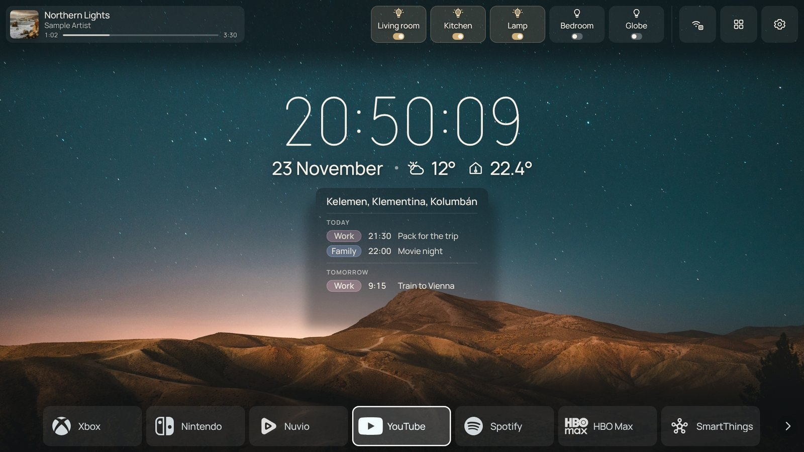
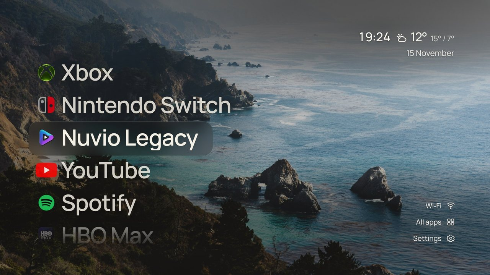

# CleanFrame (Frame Home)

> Personal fork of [nthnclrk/CleanFrame](https://github.com/nthnclrk/CleanFrame) — [bathoryalex/CleanFrame](https://github.com/bathoryalex/CleanFrame). See [FORK.md](FORK.md) and [docs/alex-tv-setup.md](docs/alex-tv-setup.md) for this installation.

A quieter home screen for Samsung TVs. Your apps, a photograph, the time and the weather, with an interface made for the TV remote.



This repo uses [Nathan Clark's CleanFrame](https://github.com/nthnclrk/CleanFrame) as a base and changes it to suit my Samsung TV (**Frame Home**, its own app identity). It is still evolving; upstream remains the better reference for a general-purpose project.

**Use it at your own risk.** Setup scripts, certificates and TV notes here match my machine and firmware. Fork again, start with the browser preview, and adapt before you install on your own hardware. Native Home/startup changes need particular care; the setup guide covers the risks and recovery steps.

| Settings | List layout |
| --- | --- |
|  |  |

## What it does

- **Home row.** Xbox and Nintendo Switch on HDMI, Nuvio, YouTube, Spotify, HBO Max, SmartThings and Internet by default. Choose and reorder up to nine apps, or add any installed app.
- **Layouts.** List or Dock, with icons, names or both, and colour or minimal (white) icons. When the apps do not fit, the Dock pages through whole tiles with arrows at the sides.
- **Clock, date and weather.** 24- or 12-hour clock, in the corner or large in the centre. An optional date ("15 November", or "November 15" in Hungarian). Weather from [Open-Meteo](https://open-meteo.com): an icon, the temperature and today's high and low.
- **Backgrounds.** A photograph, light or dark. Seventeen bundled wallpapers with pre-rendered glass, optional rotation, and **Your picture**: send any photo or short looping video from your phone and it becomes the background (see below).
- **Wi‑Fi QR.** A Home control that shows a QR code so guests can join your Wi‑Fi. The network name and password are entered on the TV and never leave it.
- **Settings.** A 4 x 2 grid of cards, made for arrow keys. Each group (Background, Layout, Typography, Focus, Apps on Home, Language and clock, Wi‑Fi QR) shows its choices beside a live Home preview. The last card opens Samsung's Home screen.
- **English or Hungarian** interface, switchable at any time.

The glass and blur are rendered ahead of time. The TV loads the finished images and uses transforms and opacity for focus feedback; nothing is blurred live while you navigate.

## Your picture

Settings → Background → **Picture from phone** shows a QR code for a private [ntfy.sh](https://ntfy.sh) channel that the TV creates for itself.

1. Scan the code with your phone. Frame Home's own [send page](docs/send/index.html) opens (served by GitHub Pages; the channel name travels in the URL fragment, which is never sent to a server).
2. Choose a photo or a short video. Photos are resized on the phone to cover 1920 x 1080 and compressed until they are at most 1.9 MB, because ntfy.sh accepts attachments up to 2 MB without an account. Videos over 1.9 MB (up to 30 seconds) are re-encoded on the phone with WebCodecs into a silent 720p H.264 MP4 at a bitrate that fits, while the clip plays once; this needs Android Chrome or iOS 16.4 or later. The MP4 is assembled with the vendored [mp4-muxer](https://github.com/Vanilagy/mp4-muxer) (MIT).
3. Send it. For a video the page first sends a still of its first frame, tagged `frame-home-still`. Within a few seconds the TV downloads the photo, crops it to 16:9, prepares the same glass materials a bundled wallpaper has, stores it, and makes it the background.

The TV keeps listening while it is on, so the QR screen can be closed; a new photo replaces the previous one. JPG, PNG, WebP and other formats the TV's browser can open work; HEIC does not.

A **video** (MP4 with H.264 works best; the send page compresses larger ones) plays muted and looped behind Home, over a photo and glass made from a still of it. Samsung TVs cannot copy a frame out of a playing video, so the still comes from the MP4's cover art (`scripts/animate-glow.py` embeds one) or from the still the send page sends first. A video with neither gets neutral dark glass. It pauses while Settings or another panel covers Home and when the app is in the background. To turn a still picture with glowing light, such as an aurora, into a gently moving loop, run `python3 scripts/animate-glow.py photo.jpg loop.mp4` (needs NumPy, Pillow and ffmpeg) and send the result; a 12-second 1080p loop with its cover comes out at about 1.8 MB. The photo passes through the public ntfy.sh server on a channel name that cannot be guessed and is deleted there after a few hours; the TV keeps its own copy. The relay host and the send page address are set in [`app/fork.js`](app/fork.js); with `sendPage` empty the QR code opens the ntfy.sh web page instead. GitHub Pages must serve `docs/` from the `main` branch for the send page to exist.

## Configure

[`app/fork.js`](app/fork.js) is the one place for this installation's settings: the Home row (with HDMI inputs and alternative app IDs), the app's own ID, the weather location and the picture relay. Interface text lives in `app/main.js` with Hungarian translations in [`app/assets/i18n.js`](app/assets/i18n.js).

## Try the interface

You need Node.js 22+ and Python 3.10+ to run the browser preview.

```sh
git clone https://github.com/bathoryalex/CleanFrame.git
cd CleanFrame
npm ci
npm run dev:public
```

Open [localhost:4795/home/](http://localhost:4795/home/). Use the arrow keys, Enter and Escape, or click the controls. App launches and Samsung screens require a TV; the preview reports that limitation when you select them.

The public preview uses the included Manrope, Geist and Newsreader fonts.

## Use a coding agent

Open this repo in a local coding agent and give it a bounded change:

```text
Read AGENTS.md, docs/development.md and docs/interaction-behaviour.md.
Help me adapt CleanFrame. Start with the public-font browser preview.
My first change is: <describe one change>.
Preserve remote navigation, saved preferences and the ES5 runtime.
Run the source checks and relevant browser checks. Show the result.
This task is browser-only: do not connect to a TV, sign or install a
package, or change Home/startup settings.
```

See [working with an agent](docs/for-agents.md) for the TV setup prompt and the distinction between UI work, app installation and native Home changes. An agent needs local computer access for TV work; a hosted chat cannot reach your TV merely by reading this repo.

## Put it on a TV

Use the staged [Samsung The Frame setup guide](docs/agent-tv-setup-guide.md) to understand the process used on my TV and adapt it to yours. It covers the remote's Developer Mode sequence, official Samsung tools, your own certificates and app identity, installation, visible checks and recovery.

The signing and TV scripts are specific to my setup. Your agent will need to adapt the paths, signing profile, identity checks and installed-app IDs, then verify each stage with you. Installing the app and assigning the remote Home button are separate steps.

| Area | Evidence and limits |
| --- | --- |
| My TV | Samsung UE75U8072, Tizen 9 |
| App installation | Frame Home (`AlexFrmH01.FrameHome`) is signed with my own certificates and installed on that TV. |
| HDMI and apps | Xbox and Switch tiles switch the HDMI input and open Samsung's TV viewer; streaming tiles launch their installed apps. |
| Still open | Remote Home routing and power-on behaviour depend on the optional native Home step; see [docs/alex-native-home.md](docs/alex-native-home.md). |
| Other TVs | No compatibility claim. This is Tizen source; Android TV, Google TV, LG webOS and Roku need their own implementations. |

The [device record](docs/tv-status.md) lists what is known about this TV. Native Home/startup uses undocumented, guarded helpers; it is optional and can fail after firmware changes. Keep a recovery baseline before attempting that work. The app can be opened manually without it.

## Develop and check

```sh
npm run check
npx playwright install chromium
CLEANFRAME_PUBLIC_FONTS=1 npm run check:browser
npm run check:public
npm run export:public
```

The browser checks use isolated Chromium profiles and a loopback preview. They never contact a TV, and the weather and picture relays are answered locally. To use an already installed Chromium, set `CLEANFRAME_CHROMIUM` to its executable. The public export creates `dist/CleanFrame-public-unsigned.wgt`, with public fonts and notices. It needs your own identity and signing before installation. It does not certify asset redistribution rights or device compatibility.

| Location | Purpose |
| --- | --- |
| `app/` | Current packaged UI and runtime assets |
| `scripts/` | Preview, validation, asset generation and reference TV tools |
| [Development](docs/development.md) / [testing](docs/testing.md) | Runtime map, preferences, checks and device boundaries |
| [Assets](docs/assets.md) / [third-party notices](THIRD_PARTY_NOTICES.md) | Rendering recipes, font separation and asset provenance |
| [Asset sources](docs/asset-sources.md) | Photo credits and verification of the bundled third-party assets |
| `.local/`, `dist/` | Ignored private setup, recovery data, generated files and packages |

## Contribute

Fork it, experiment and build something that suits your TV. If you find a useful fix or improve the setup instructions, contributions are welcome. Read [CONTRIBUTING.md](CONTRIBUTING.md) before a larger change. Reports should include model, firmware and the observed result, with private identifiers removed.

## Licence and credits

CleanFrame's original code and documentation use the [MIT licence](LICENSE). Fonts, photographs and logos retain their own terms; read [THIRD_PARTY_NOTICES.md](THIRD_PARTY_NOTICES.md). Paid Pangram binaries are excluded from Git and public exports. A local package may include them, so keep personal builds separate from public downloads.

The [release review](docs/public-release.md) records the publication checks. Third-party assets retain the terms listed in their notices. CleanFrame is an independent project with no Samsung or streaming-service affiliation.

[TV Detox](https://github.com/Ansub/tv-detox) is a useful example of making an agent-assisted TV project approachable. Its Android setup is a different implementation; the prompts and instructions here are written for CleanFrame and Tizen.
